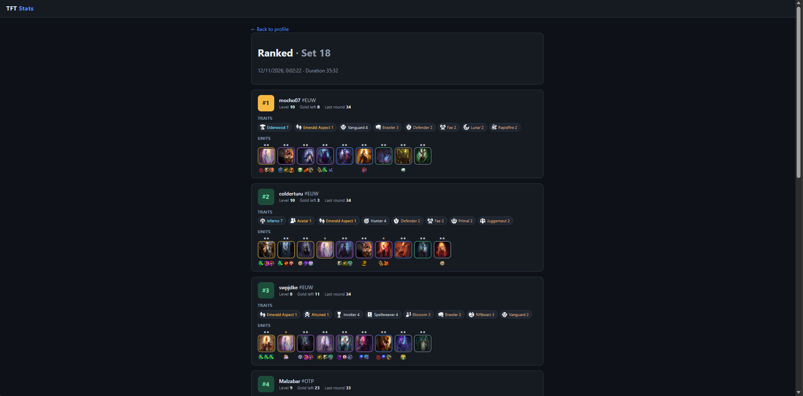

# TFT Stats
Stats platform for Teamfight Tactics built on the official Riot Games API.




## Features
- Search any player by Riot ID
- Summoner icon, ranked emblem, tier, division and LP
- Average placement, top 4 rate and 1st place rate
- Match history with game mode filter (Ranked, Normal, Hyper Roll, Double Up) and "load more"
- Match detail with the full lobby: champion icons, star levels, items and traits
- Click any player in a match to open their profile
- Matches are stored in MySQL, so repeated searches do not use the Riot API

## Stack
- Backend: Java, Spring Boot, Spring Data JPA, Flyway
- Frontend: Angular
- Database: MySQL (Docker Compose)

## How to run
1. Requirements: JDK 21+, Node.js, Angular CLI and Docker Desktop
2. Copy `.env.example` to `.env` and fill in your Riot API key and database passwords
3. Start the database (repository root): `docker compose up -d`
4. Start the backend: `cd backend` and `.\mvnw.cmd spring-boot:run`
5. Start the frontend: `cd frontend`, `npm install` and `ng serve`
6. Open http://localhost:4200

Icons and static data are included in the repository. To refresh them for a new set, run `scripts/download-static-data.ps1`.

## Configuration

### 1. Get a Riot API key
1. Go to https://developer.riotgames.com and sign in with your Riot account
2. In the dashboard, copy your **Development API Key** (it starts with `RGAPI-`)
3. Development keys expire every 24 hours: click **Regenerate API Key** in the dashboard when it stops working and update your `.env`

The development key is personal and rate limited (20 requests per second and 100 every 2 minutes). The app already includes a rate limiter and stores matches in the database to use as few requests as possible. To run a public deployment you need to register the product in the Riot Developer Portal and request a production key.

### 2. Create your `.env`
Copy `.env.example` to `.env` in the repository root and fill it in. Do not use quotes or spaces around the `=`:

```
RIOT_API_KEY=RGAPI-your-key
MYSQL_ROOT_PASSWORD=choose-a-password
MYSQL_DATABASE=tftstats
MYSQL_USER=tftstats
MYSQL_PASSWORD=choose-another-password
```

The `.env` file is ignored by Git. Never commit your API key.

### 3. Region
The backend is configured for EUW. To use another region, change these two lines in `backend/src/main/resources/application.properties`:

| Region | `riot.regional-host` | `riot.platform-host` |
|---|---|---|
| EUW | `https://europe.api.riotgames.com` | `https://euw1.api.riotgames.com` |
| NA | `https://americas.api.riotgames.com` | `https://na1.api.riotgames.com` |
| KR | `https://asia.api.riotgames.com` | `https://kr.api.riotgames.com` |

A region selector is planned for a future version.

## DISCLAIMER
"tft-stats" isn't endorsed by Riot Games and doesn't reflect the views or opinions of Riot Games or anyone officially involved in producing or managing Riot Games properties. Riot Games, and all associated properties are trademarks or registered trademarks of Riot Games, Inc.