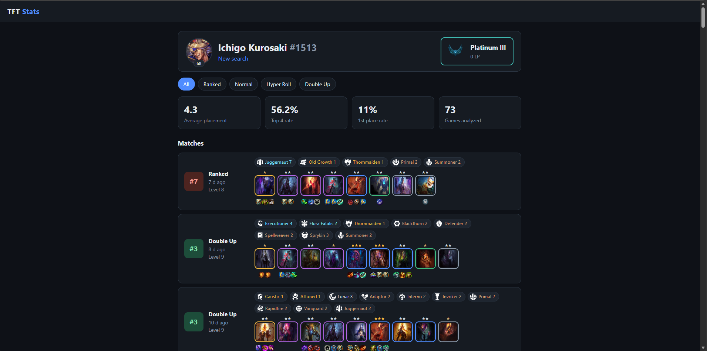

# TFT Stats
Stats platform for Teamfight Tactics built on the official Riot Games API.

## Features
- Search any player by Riot ID
- Summoner icon, ranked emblem, tier, division and LP
- Average placement, top 4 rate and 1st place rate
- Match history with game mode filter (Ranked, Normal, Hyper Roll, Double Up) and "load more"
- Match detail with the full lobby: champion icons, star levels, items and traits
- Click any player in a match to open their profile
- Matches are stored in MySQL, so repeated searches do not use the Riot API

## Stack
- Backend: Java, Spring Boot, Spring Data JPA, Flyway
- Frontend: Angular
- Database: MySQL (Docker Compose)

## How to run
1. Requirements: JDK 21+, Node.js, Angular CLI and Docker Desktop
2. Copy `.env.example` to `.env` and fill in your Riot API key and database passwords
3. Start the database (repository root): `docker compose up -d`
4. Start the backend: `cd backend` and `.\mvnw.cmd spring-boot:run`
5. Start the frontend: `cd frontend`, `npm install` and `ng serve`
6. Open http://localhost:4200

Icons and static data are included in the repository. To refresh them for a new set, run `scripts/download-static-data.ps1`.

## Architecture notes
- The backend exposes its own models instead of Riot's raw JSON
- A sliding window rate limiter keeps requests under the Riot development key limits
- Matches are stored as received from Riot plus an index table, and served from the database afterwards

## Disclaimer
(keep your existing disclaimer text here)

## DISCLAIMER
"tft-stats" isn't endorsed by Riot Games and doesn't reflect the views or opinions of Riot Games or anyone officially involved in producing or managing Riot Games properties. Riot Games, and all associated properties are trademarks or registered trademarks of Riot Games, Inc.